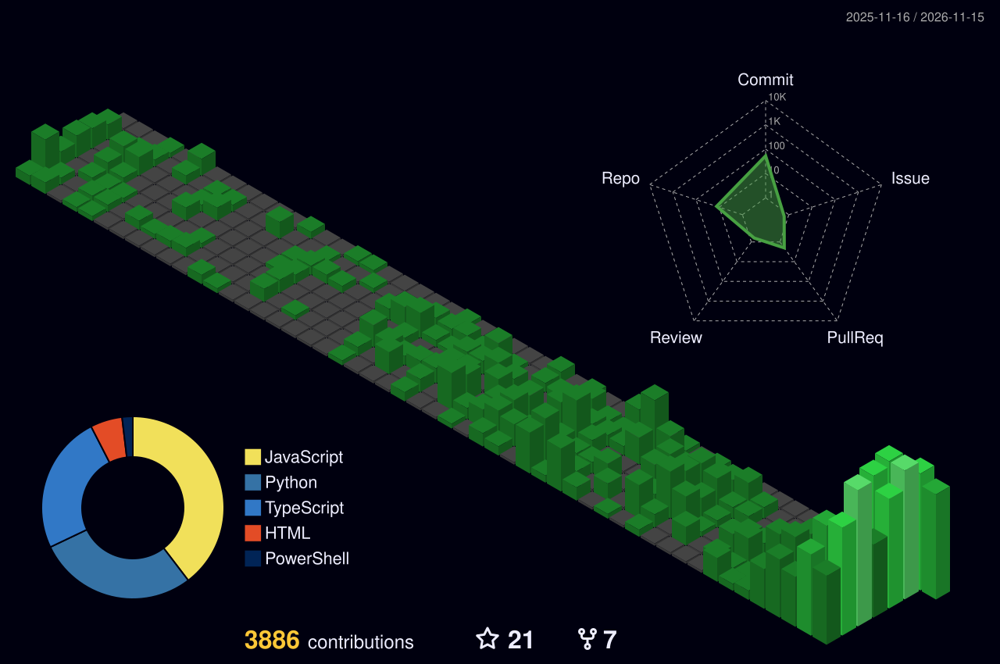

<!-- Generated by scripts/readme.mjs from data/*.json. Edit those files, not this one. -->

<picture><source media="(prefers-color-scheme: dark)" srcset="assets/brain-dark.svg"><source media="(prefers-color-scheme: light)" srcset="assets/brain-light.svg"></picture>

[YouTube](https://www.youtube.com/@SuperSharyG63) · [Instagram](https://www.instagram.com/supershary.ai) · [Discord](https://discord.gg/HyWFsTt8th) · [LinkedIn](https://www.linkedin.com/in/supershary) · [X](https://x.com/supersharyai)

AI and product at [Proxsoft](https://proxsoftglobal.com). I build AI agents for construction finance that work on top of the ERP a company already runs. On my own time I build Orbital Browser, Rootaxe and Nebulaform, and I teach AI automation as SuperShary.

### Now building · week of 20 Nov 2026

- Proxsoft: a marketplace of AI agents for construction finance, not a single tool. AP automation is the first agent, and it is live.
- Orbital Browser: getting the preview ready for the waitlist.
- Nebulaform: sign-up is now open to everyone.

### At Proxsoft

- **Nexus** · *In production* AP automation. An invoice arrives by email or upload, gets read and matched to its purchase order, and posts to the ERP only after a person approves.
- **[Foremind](https://proxsoftglobal.com/foremind-ap-automation/)** · *Shown in live demos* AI agents for construction ERPs. The first module is AP automation: invoices in, matched and ready to approve.

### My products

- **[Orbital Browser](https://orbitalbrowser.com)** · *Coming soon, waitlist open* The browser your AI agent drives. It reads pages as small text slices, and anything that posts, sends, pays or deletes waits for your click.
- **[Rootaxe](https://rootaxe.com)** · *Not out yet, early access open* Control your Mac from your iPhone, Apple Watch and AirPods.
- **[Nebulaform](https://nebulaform.vercel.app)** · *Live, sign-up open* Describe a form and it builds itself: fields, validation, a shareable link and the responses.
- **[Lookout](https://lookout.neurobaselabs.com)** · *Early access* One private memory of your meetings that you can ask from Claude Code, with every answer traced to its source.

### Open source

- **[Claude Council](https://github.com/SuperShary/claude-council)** · ★ 2 · [site](https://supershary.github.io/claude-council/) A Claude skill where 80 legendary minds argue your decision in character and a High Council hands back one verdict.
- **[Verdict](https://github.com/SuperShary/verdict-proof)** · [live](https://verdict-chi-one.vercel.app) · [film](https://youtu.be/FGKhSeXxdio) Invoice PDF in, a reasoned approve, hold, reject or block decision out, proven with a seeded stress test.

More public repos: [multi-agent-invoice-reconciliation-system](https://github.com/SuperShary/multi-agent-invoice-reconciliation-system) · [Building-an-AI-agent-Chrome-extension](https://github.com/SuperShary/Building-an-AI-agent-Chrome-extension) · [Holospeed](https://github.com/SuperShary/Holospeed) · [Lamborgini](https://github.com/SuperShary/Lamborgini) · [monsterenergy](https://github.com/SuperShary/monsterenergy) · [beyondchats](https://github.com/SuperShary/beyondchats) · [Resume-Analyzer-Pro](https://github.com/SuperShary/Resume-Analyzer-Pro) · [infocream_web](https://github.com/SuperShary/infocream_web) · [nexuspredictai](https://github.com/SuperShary/nexuspredictai) · [cinematch](https://github.com/SuperShary/cinematch) · [aidoctor](https://github.com/SuperShary/aidoctor) · [jbl](https://github.com/SuperShary/jbl) · [FluxColab](https://github.com/SuperShary/FluxColab) · [jarvis](https://github.com/SuperShary/jarvis)

### Channels

- **[SuperShary](https://www.youtube.com/@SuperSharyG63)** on YouTube · 756 subscribers Tools, agents and real builds with AI, in Hindi and English.
- **[Shagun Choudhary](https://www.youtube.com/@Shagunchoudharyrocks)** on YouTube · 1,410 subscribers Car explainers for Indian buyers.
- **[SuperShary AI Community](https://discord.gg/HyWFsTt8th)** on Discord Questions, builds and job help.

### By the numbers

<picture><source media="(prefers-color-scheme: dark)" srcset="assets/data-dark.svg"><source media="(prefers-color-scheme: light)" srcset="assets/data-light.svg"></picture>

A GitHub Action pulls every number from the GitHub API and the public YouTube pages, every day. The contribution count is GitHub's own, which includes private work.

**Stack:** TypeScript · Next.js · Node · Python · Swift · Electron · Supabase · Azure · Vercel · MCP

<picture>
  <source media="(prefers-color-scheme: dark)" srcset="profile-3d-contrib/profile-night-green.svg" />
  <source media="(prefers-color-scheme: light)" srcset="profile-3d-contrib/profile-green.svg" />
  
</picture>

<picture>
  <source media="(prefers-color-scheme: dark)" srcset="https://raw.githubusercontent.com/SuperShary/SuperShary/output/github-snake-dark.svg" />
  <source media="(prefers-color-scheme: light)" srcset="https://raw.githubusercontent.com/SuperShary/SuperShary/output/github-snake.svg" />
  
</picture>

This profile rebuilds itself every day. The brain and the data card are drawn by <a href="scripts">my own generator</a> (<a href="docs/RESEARCH-v3.md">how it works</a>). Last run 2026-11-20.

