<!-- Generated by scripts/readme.mjs from data/*.json. Edit those files, not this one. -->

<picture><source media="(prefers-color-scheme: dark)" srcset="assets/brain-dark.svg"><source media="(prefers-color-scheme: light)" srcset="assets/brain-light.svg"></picture>

<a href="https://www.linkedin.com/in/supershary"><picture><source media="(prefers-color-scheme: dark)" srcset="assets/v5/pill-linkedin-dark.svg"><source media="(prefers-color-scheme: light)" srcset="assets/v5/pill-linkedin-light.svg"></picture></a>
<a href="https://www.youtube.com/@SuperSharyG63"><picture><source media="(prefers-color-scheme: dark)" srcset="assets/v5/pill-youtube-dark.svg"><source media="(prefers-color-scheme: light)" srcset="assets/v5/pill-youtube-light.svg"></picture></a>
<a href="https://www.instagram.com/supershary.ai"><picture><source media="(prefers-color-scheme: dark)" srcset="assets/v5/pill-instagram-dark.svg"><source media="(prefers-color-scheme: light)" srcset="assets/v5/pill-instagram-light.svg"></picture></a>
<a href="https://discord.gg/HyWFsTt8th"><picture><source media="(prefers-color-scheme: dark)" srcset="assets/v5/pill-discord-dark.svg"><source media="(prefers-color-scheme: light)" srcset="assets/v5/pill-discord-light.svg"></picture></a>
<a href="https://x.com/supersharyai"><picture><source media="(prefers-color-scheme: dark)" srcset="assets/v5/pill-x-dark.svg"><source media="(prefers-color-scheme: light)" srcset="assets/v5/pill-x-light.svg"></picture></a>
<a href="https://www.youtube.com/@Shagunchoudharyrocks"><picture><source media="(prefers-color-scheme: dark)" srcset="assets/v5/pill-cars-dark.svg"><source media="(prefers-color-scheme: light)" srcset="assets/v5/pill-cars-light.svg"></picture></a>

Founder's Office, AI & GTM at <a href="https://proxsoftglobal.com">Proxsoft</a>. I build AI agents for construction finance that work on top of the ERP a company already runs. On my own time I build Orbital Browser, Rootaxe and Nebulaform, and I teach AI automation as SuperShary.

<a href="https://proxsoftglobal.com/foremind-ap-automation/"><picture><source media="(prefers-color-scheme: dark)" srcset="assets/v5/proxsoft-dark.svg"><source media="(prefers-color-scheme: light)" srcset="assets/v5/proxsoft-light.svg">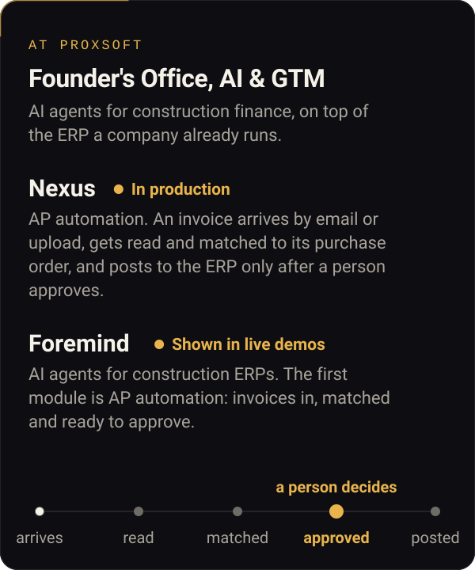</picture></a>
<picture><source media="(prefers-color-scheme: dark)" srcset="assets/v5/now-dark.svg"><source media="(prefers-color-scheme: light)" srcset="assets/v5/now-light.svg">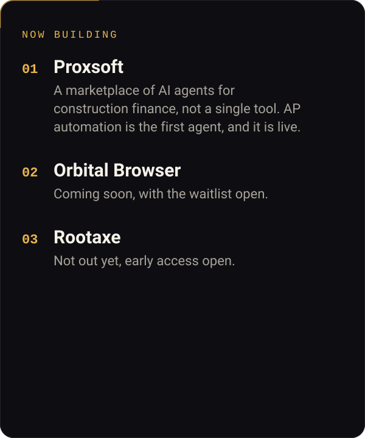</picture>

 

<a href="https://orbitalbrowser.com"><picture><source media="(prefers-color-scheme: dark)" srcset="assets/v5/product-orbital-dark.svg"><source media="(prefers-color-scheme: light)" srcset="assets/v5/product-orbital-light.svg">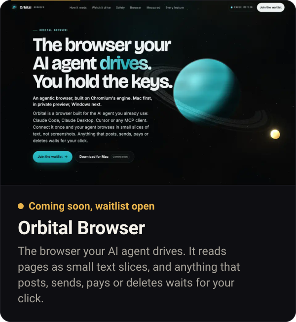</picture></a>
<a href="https://rootaxe.com"><picture><source media="(prefers-color-scheme: dark)" srcset="assets/v5/product-rootaxe-dark.svg"><source media="(prefers-color-scheme: light)" srcset="assets/v5/product-rootaxe-light.svg">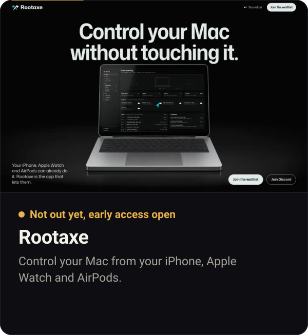</picture></a>
 
<a href="https://nebulaform.vercel.app"><picture><source media="(prefers-color-scheme: dark)" srcset="assets/v5/product-nebulaform-dark.svg"><source media="(prefers-color-scheme: light)" srcset="assets/v5/product-nebulaform-light.svg">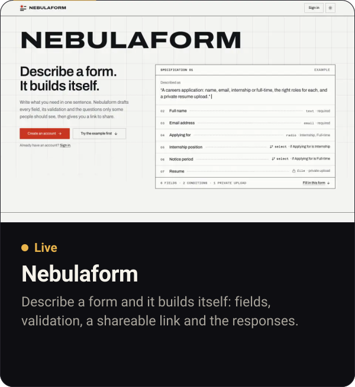</picture></a>
<a href="https://lookout.neurobaselabs.com"><picture><source media="(prefers-color-scheme: dark)" srcset="assets/v5/product-lookout-dark.svg"><source media="(prefers-color-scheme: light)" srcset="assets/v5/product-lookout-light.svg">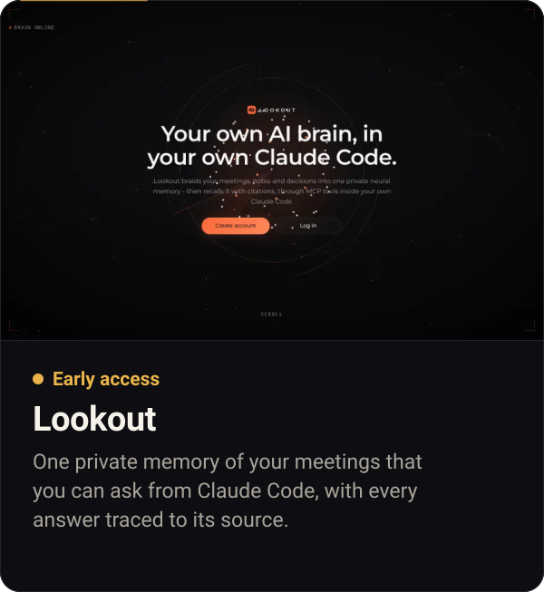</picture></a>

 

<a href="https://github.com/SuperShary/claude-council"><picture><source media="(prefers-color-scheme: dark)" srcset="assets/v5/oss-claude-council-dark.svg"><source media="(prefers-color-scheme: light)" srcset="assets/v5/oss-claude-council-light.svg">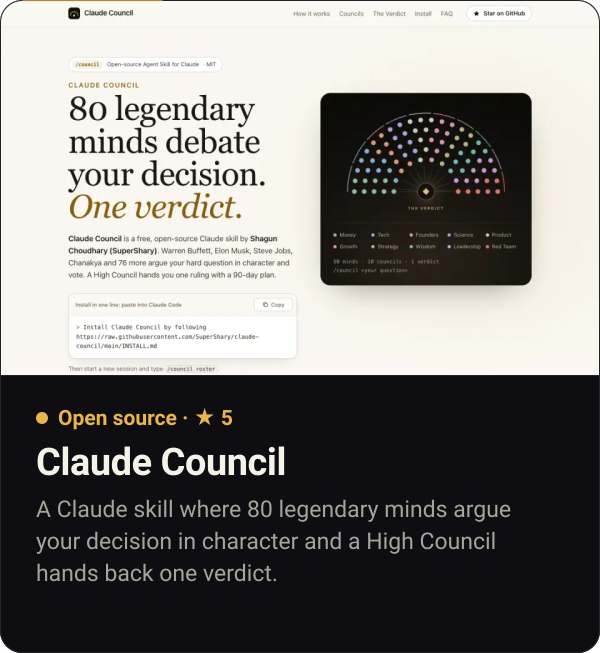</picture></a>
<a href="https://github.com/SuperShary/verdict-proof"><picture><source media="(prefers-color-scheme: dark)" srcset="assets/v5/oss-verdict-proof-dark.svg"><source media="(prefers-color-scheme: light)" srcset="assets/v5/oss-verdict-proof-light.svg">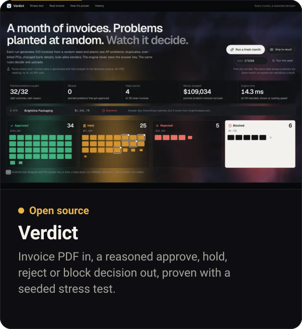</picture></a>

<a href="https://supershary.github.io/claude-council/">Claude Council site</a> · <a href="https://verdict-chi-one.vercel.app">Verdict live</a> · <a href="https://youtu.be/FGKhSeXxdio">Verdict film</a>

 

<picture><source media="(prefers-color-scheme: dark)" srcset="assets/v5/year-dark.svg"><source media="(prefers-color-scheme: light)" srcset="assets/v5/year-light.svg">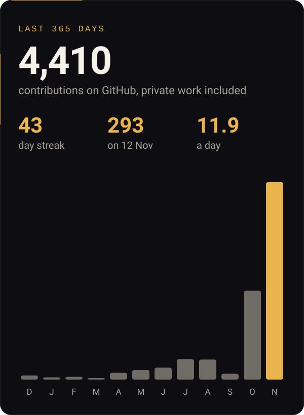</picture>
<picture><source media="(prefers-color-scheme: dark)" srcset="assets/v5/reach-dark.svg"><source media="(prefers-color-scheme: light)" srcset="assets/v5/reach-light.svg">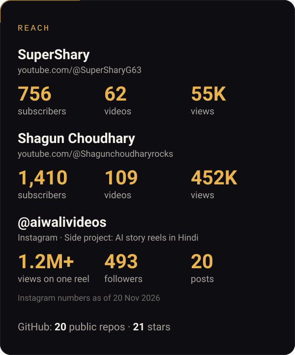</picture>

<picture>
  <source media="(prefers-color-scheme: dark)" srcset="https://raw.githubusercontent.com/SuperShary/SuperShary/output/github-snake-dark.svg" />
  <source media="(prefers-color-scheme: light)" srcset="https://raw.githubusercontent.com/SuperShary/SuperShary/output/github-snake.svg" />
  
</picture>

Every picture on this page is drawn by <a href="scripts">my own generator</a> and rebuilt every day from GitHub and YouTube numbers. Last run 2026-11-20.

