<!-- Generated by scripts/readme.mjs from data/*.json. Edit those files, not this one. -->

<picture><source media="(prefers-color-scheme: dark)" srcset="assets/brain-dark.svg"><source media="(prefers-color-scheme: light)" srcset="assets/brain-light.svg"></picture>

### ⚡ Building this week · week of 19 Oct 2026

- Nexus AI: the next release and the new design for the first client
- SuperShary OS: a team of AI agents running the company's daily work
- This profile: a generator that turns my last 365 days into a rotating brain

### 📊 Data profile

<picture><source media="(prefers-color-scheme: dark)" srcset="assets/data-dark.svg"><source media="(prefers-color-scheme: light)" srcset="assets/data-light.svg"></picture>

A GitHub Action pulls every number here from the GitHub API and the public YouTube channel pages, every day. None of it is typed by hand.

**Stack:** TypeScript · Next.js · Node · Python · Swift · Electron · Fastify · SQLite · Azure · Vercel · n8n · FFmpeg · three.js

### 🧠 Projects · every card opens the project

<a href="https://verdict-chi-one.vercel.app"><picture><source media="(prefers-color-scheme: dark)" srcset="assets/cards/verdict-proof-dark.svg"><source media="(prefers-color-scheme: light)" srcset="assets/cards/verdict-proof-light.svg"></picture></a>
<a href="https://supershary.github.io/claude-council/"><picture><source media="(prefers-color-scheme: dark)" srcset="assets/cards/claude-council-dark.svg"><source media="(prefers-color-scheme: light)" srcset="assets/cards/claude-council-light.svg"></picture></a>
 
<a href="https://github.com/SuperShary/multi-agent-invoice-reconciliation-system"><picture><source media="(prefers-color-scheme: dark)" srcset="assets/cards/multi-agent-invoice-reconciliation-system-dark.svg"><source media="(prefers-color-scheme: light)" srcset="assets/cards/multi-agent-invoice-reconciliation-system-light.svg"></picture></a>
<a href="https://github.com/SuperShary/Building-an-AI-agent-Chrome-extension"><picture><source media="(prefers-color-scheme: dark)" srcset="assets/cards/Building-an-AI-agent-Chrome-extension-dark.svg"><source media="(prefers-color-scheme: light)" srcset="assets/cards/Building-an-AI-agent-Chrome-extension-light.svg"></picture></a>
 
<a href="https://holospeed.vercel.app"><picture><source media="(prefers-color-scheme: dark)" srcset="assets/cards/Holospeed-dark.svg"><source media="(prefers-color-scheme: light)" srcset="assets/cards/Holospeed-light.svg"></picture></a>
<a href="https://lamborgini-mu.vercel.app"><picture><source media="(prefers-color-scheme: dark)" srcset="assets/cards/Lamborgini-dark.svg"><source media="(prefers-color-scheme: light)" srcset="assets/cards/Lamborgini-light.svg"></picture></a>
 
<a href="https://monsterenergy-theta.vercel.app"><picture><source media="(prefers-color-scheme: dark)" srcset="assets/cards/monsterenergy-dark.svg"><source media="(prefers-color-scheme: light)" srcset="assets/cards/monsterenergy-light.svg"></picture></a>
<a href="https://github.com/SuperShary/beyondchats"><picture><source media="(prefers-color-scheme: dark)" srcset="assets/cards/beyondchats-dark.svg"><source media="(prefers-color-scheme: light)" srcset="assets/cards/beyondchats-light.svg"></picture></a>

### 🎬 Channels

<a href="https://www.youtube.com/@SuperSharyG63"><picture><source media="(prefers-color-scheme: dark)" srcset="assets/cards/yt-SuperSharyG63-dark.svg"><source media="(prefers-color-scheme: light)" srcset="assets/cards/yt-SuperSharyG63-light.svg"></picture></a>
<a href="https://www.youtube.com/@Shagunchoudharyrocks"><picture><source media="(prefers-color-scheme: dark)" srcset="assets/cards/yt-Shagunchoudharyrocks-dark.svg"><source media="(prefers-color-scheme: light)" srcset="assets/cards/yt-Shagunchoudharyrocks-light.svg"></picture></a>

### 🔒 In production, private code

<picture><source media="(prefers-color-scheme: dark)" srcset="assets/cards/private-0-dark.svg"><source media="(prefers-color-scheme: light)" srcset="assets/cards/private-0-light.svg"></picture>
<picture><source media="(prefers-color-scheme: dark)" srcset="assets/cards/private-1-dark.svg"><source media="(prefers-color-scheme: light)" srcset="assets/cards/private-1-light.svg"></picture>

### 🔗 Every link

| Project | Code | Open |
|---|---|---|
| **Verdict** | [verdict-proof](https://github.com/SuperShary/verdict-proof) | [live](https://verdict-chi-one.vercel.app) · [film](https://youtu.be/FGKhSeXxdio) |
| **Claude Council** | [claude-council](https://github.com/SuperShary/claude-council) | [site](https://supershary.github.io/claude-council/) |
| **Invoice Reconciliation Agents** | [multi-agent-invoice-reconciliation-system](https://github.com/SuperShary/multi-agent-invoice-reconciliation-system) | · |
| **Agent Chrome Extension** | [Building-an-AI-agent-Chrome-extension](https://github.com/SuperShary/Building-an-AI-agent-Chrome-extension) | · |
| **Holospeed** | [Holospeed](https://github.com/SuperShary/Holospeed) | [live](https://holospeed.vercel.app) |
| **Aventador Scrollytelling** | [Lamborgini](https://github.com/SuperShary/Lamborgini) | [live](https://lamborgini-mu.vercel.app) |
| **Monster Energy Scrollytelling** | [monsterenergy](https://github.com/SuperShary/monsterenergy) | [live](https://monsterenergy-theta.vercel.app) |
| **LLM Response Evaluator** | [beyondchats](https://github.com/SuperShary/beyondchats) | · |

More public repos: [Resume-Analyzer-Pro](https://github.com/SuperShary/Resume-Analyzer-Pro) · [infocream_web](https://github.com/SuperShary/infocream_web) · [nexuspredictai](https://github.com/SuperShary/nexuspredictai) · [cinematch](https://github.com/SuperShary/cinematch) · [aidoctor](https://github.com/SuperShary/aidoctor) · [jbl](https://github.com/SuperShary/jbl) · [FluxColab](https://github.com/SuperShary/FluxColab) · [jarvis](https://github.com/SuperShary/jarvis)

### 🌌 Activity

<picture>
  <source media="(prefers-color-scheme: dark)" srcset="profile-3d-contrib/profile-night-green.svg" />
  <source media="(prefers-color-scheme: light)" srcset="profile-3d-contrib/profile-green.svg" />
  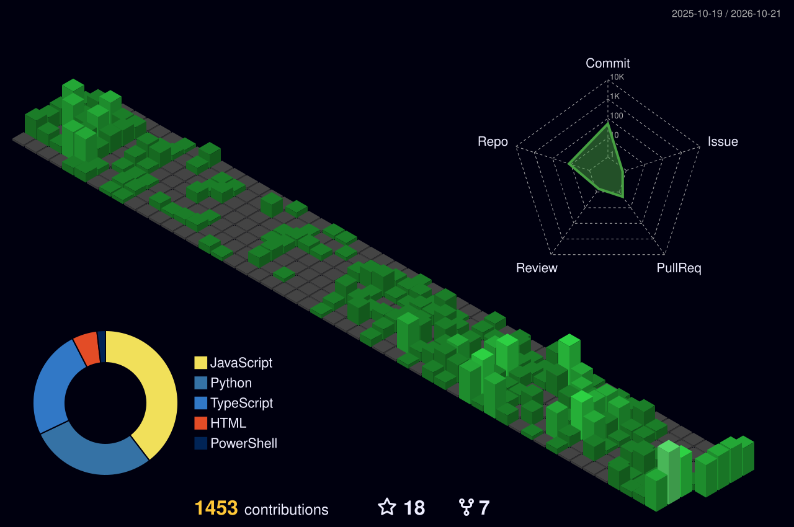
</picture>

<picture>
  <source media="(prefers-color-scheme: dark)" srcset="https://raw.githubusercontent.com/SuperShary/SuperShary/output/github-snake-dark.svg" />
  <source media="(prefers-color-scheme: light)" srcset="https://raw.githubusercontent.com/SuperShary/SuperShary/output/github-snake.svg" />
  
</picture>

This profile rebuilds itself every day. The brain, the data card and the cards are drawn by <a href="scripts">my own generator</a> (<a href="docs/RESEARCH-v3.md">how it works</a>). Last run 2026-10-24.

